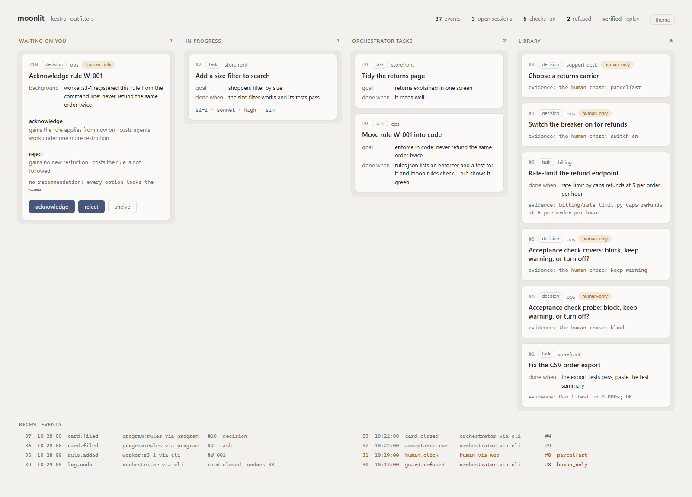
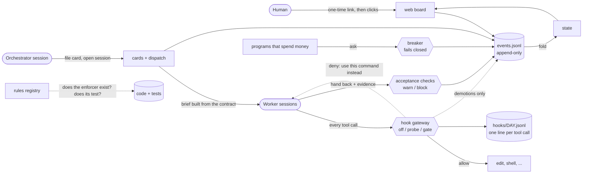

# moonlit-core

**Rules-as-code orchestration for a fleet of coding agents.**

One orchestrator session hands out work as cards. Worker sessions do the work. Nobody gets to say "done" without evidence, guardrails run at tool-call time, and the human's queue holds only what only the human can do.

> **158 agent sessions dispatched in 52 hours, 92 of them in one day. 619 cards and 2,726 events in 4.5 days. One human in the loop.**
> From the first days of the private system this was extracted from, 18–23 November 2026. [How these were counted.](docs/provenance.md#numbers)

**This is the showcase: what moonlit-core is, how it is built, how it was evaluated and where it fails.** It carries no code. The source, a clean rewrite in 15 Python files with their tests, is in a private repository for now; where these pages say *this repo* or *the public version*, or name a file or a test, they mean that source. The demo is one command, `python -m moonlit demo`, with nothing to install and no API key. Its complete output is in [demo/transcript.txt](demo/transcript.txt), and the picture below is the web board when it has finished.

**Who did what.** I set the operating model and made or approved every decision under [Decisions](#decisions); that section marks which were my own and which came from a review. Claude Code wrote most of the code, working under those rules. The codebase is small on purpose: 15 files, about 4,000 lines, more than 500 tests.

---

## The problem

In November 2026 I ran my day-to-day projects through Claude Code: one long-lived orchestrator session took my requests and handed them to worker sessions. On the busiest day it opened 92 of them.

The rules of that operation lived in prompt files. That stopped working quickly.

- **"Done" was a sentence, not a fact.** A session could say a task was finished and nothing checked.
- **Work went missing.** I audited two days of it: of roughly 117 tasks, 10 could be traced from request to result, and 28 had been handed to an agent with no record at all.
- **Rules decayed.** A rule I stated out loud got written into a document. Whether anything enforced it, nobody could say.
- **I became the queue.** Reports, status notes and questions piled into the one place that was supposed to show me only the decisions that needed me.

More prompt text fixed none of this. Moving the rules into code is what started to.

**How old this is.** The orchestrator has run since 1 November. The mechanisms in this repo are younger: the event log started on 18 November, dispatch-by-card on the 21st, hooks and acceptance checks on the 22nd. The production numbers here cover days, not months, and several guardrails were still in their warning week when I extracted this. Where that matters, I say so.

## Five ideas

| | Idea | Code | Came from |
|---|---|---|---|
| 1 | **Dispatch is a card.** Work reaches an agent only as a card with a contract: a goal and a done-when, usually also what to read first and what not to touch. No card, no session. | `cards.py` `dispatch.py` | [INC-001](docs/incidents.md#inc-001) |
| 2 | **"Done" needs evidence.** Handing a card back runs acceptance checks in plain code, no model. New checks only warn; a human decides when one is allowed to block. Until then a weak hand-back is accepted with its warnings. | `handback.py` `acceptance.py` `transcripts.py` | [DEC-005](docs/decisions.md#dec-005) |
| 3 | **Rules live in code, not prose.** Each operating rule is registered with the function that enforces it and the test that pins it. Its status is computed, never typed in. | `rules.py` `rules.json` | [INC-007](docs/incidents.md#inc-007) |
| 4 | **Guardrails at tool-call time.** One hook entry sits between the agent and its tools: off, probe, or gate. It fails open. In front of money and account actions sits a kill switch that fails closed. | `hooks.py` `breaker.py` | [INC-008](docs/incidents.md#inc-008) |
| 5 | **The human queue holds only what only the human can do.** One function defines it. A human answer counts only if it came through the human's door, not from an agent typing the same command. | `cards.py` `web.py` | [INC-011](docs/incidents.md#inc-011) |

Under all five is an append-only event log (`events.py`). State is a fold of that log (`state.py`): a crash costs at most the one line being written, an undo is one more event, and every count on the board can be recomputed from it.

## What the demo shows

`python -m moonlit demo` plays eight short acts in a little over a minute, in a throwaway workspace for an invented company. Nothing in it is mocked that could be real: files are written, a small test suite runs, the log is torn and replayed.

1. **Dispatch is a card.** The orchestrator files tasks; opening a session for a task with no contract is refused.
2. **A diligent worker** fixes a failing test and hands back with the real test output. Accepted.
3. **A sloppy worker** says "done, all good". Refused. It tries again, repeating the done-when text; the text check notices the parroting and the executable probe disagrees. Those are warnings — until the human promotes the probe to block.
4. **Guardrails at tool-call time.** A worker reaches for a do-not-touch file, then for the ledger itself; each time it is denied and told which command to use instead. The orchestrator tries to do the work itself and is denied too.
5. **Kill switch.** A refund is requested and denied, because the breaker is off. The human switches it on; the refund goes through once, and the same request repeated is not paid twice.
6. **Human-only.** A decision lands in "Waiting on you". A shell that says it is the human, then the orchestrator, try to answer it from the CLI; a page on another site and a local script without the board's key try the web API; a worker tries to start a board of its own. All refused, and the two command-line clicks are logged as refusals. The human's click on the board is accepted.
7. **Crash and replay.** The log is cut off mid-write. On restart the state is rebuilt from the log and verified, and a mistaken close is undone.
8. **Rules registry.** Every rule with its computed status: green only when the function that enforces it and the test that pins it both exist. A rule typed at the command line waits as prose until someone moves it into code.

The complete terminal output is in [demo/transcript.txt](demo/transcript.txt). `python -m moonlit demo --serve` plays the same story on the web board.

## Architecture

**Life of a card.**
1. The orchestrator files a `task` with a contract. Filing the same task twice updates the first card. The contract belongs to whoever dispatched the card: a worker that files it again with other terms is refused and the attempt is logged, and anything else a worker files is a request the orchestrator has to approve.
2. `moon open` turns the contract into the worker's brief and registers the session; it starts nothing. No contract, no session (exit code 5).
3. While the worker runs, each tool call passes the hook gateway. With the gate on, three categories block from the start: what the card says not to touch, moonlit's own files, and the human's door. What they protect is written down, on the card or in moonlit itself, so they never switch themselves back to observe. The fourth, an orchestrator doing the work itself, ships in observe.
4. The worker hands back the card its session was opened for, and no other, with evidence. Evidence that is nothing but filler ("done, all good") is refused outright. Then four checks run: is there anything to check and do the files it names exist, does it cover each done-when clause, did this session write to a forbidden file, does the card's probe pass.
5. Each check is in `warn`, `block` or `off`. Warn accepts and says what looked wrong. Only the human moves a check to `block`: with a click on the board, or by editing the config file, which the gate keeps agents out of as far as a command line can be read (the FAQ says where that ends).
6. Every change above is an event. The board, the inbox and the reports are views over the log.

## Decisions

◆ I proposed it, or chose it among options. ◇ Someone else proposed it — an external review or a worker session — and I approved it, sometimes with changes. All twenty, with context and alternatives, are in [docs/decisions.md](docs/decisions.md).

| | Decision | Why | What it costs |
|---|---|---|---|
| ◆ 1 Nov | One orchestrator that only dispatches. It does no work itself. | I interrupt it constantly. It has to be free to answer. | Every task pays a hand-off. |
| ◇ 21 Nov | Dispatch is a card. No card, no session. A session proposed it after the audit; I approved it. | 28 of ~117 tasks had no record. | A card before any work, even small work. |
| ◆ 22 Nov | Rules belong in code. A rule that cannot be code is listed as prose-only, with the reason; one that should be code and is not shows red. | Sessions read prose differently, and the orchestrator repeated mistakes it had been warned about. | Adding a rule is slower. Some rules cannot be code. |
| ◇ ◆ 22 Nov | New checks only warn for a week (a review's proposal). Then I decide per check: block, keep warning, or switch off. My half: the card that asks me shows no recommendation and identical buttons. | A check with false alarms teaches everyone to ignore it. And an agent recommending settings for its own guardrails is grading itself. | A week in which a real problem only gets a warning. |
| ◇ 22 Nov | An answer to a human-only card counts only if it came through the web board. | An agent can run the same command I would. A CLI close proves nothing about who decided. | I have to open the board. |
| ◆ 22 Nov | My approval is spent only on decisions made once that keep working. A review wanted me to click on every rule edit; I refused that, and I refused a program clicking for me. | Approval fatigue turns a human check into a reflex. | New restrictive rules wait for me before they apply. |
| ◆ 22 Nov | The inbox holds decisions, hands-on steps and dated items. Reports go to a library. | I was reading things that did not need me. | A report quietly waiting for a choice goes unseen unless it becomes a decision card. |
| ◆ 22 Nov | Effort level stays the orchestrator's judgment. A review proposed a fixed table by type of work; I kept it as a suggestion only. | Not every rule should become code. A table cannot see the task. | Judgment is less consistent than a table. |
| ◇ 22 Nov | Hooks fail open; the kill switch in front of money and account actions fails closed. | A broken hook must not freeze every agent. A broken breaker must not spend money. | A hook bug lets things through until someone reads the error log. |

## Evaluation

The guardrails are deterministic code, and they still need evals. The questions are the ones you would ask of a classifier: what does it catch, what does it miss, and how often does it stop honest work?

`python evals/run.py` runs labeled cases and prints this table; it takes a minute or two. The complete output, with every known miss and the reason for it, is in [evals/results/latest.md](evals/results/latest.md). Each failure class in the suites traces back to something that happened.

| Suite | Judgements | Precision | Recall | False-block rate | Known misses | Known false blocks |
|---|---|---|---|---|---|---|
| Hand-back (acceptance checks) | 89 | 0.98 | 0.86 | 0.04 | 9 | 1 |
| Tool calls (hook gates) | 145 | 0.99 | 0.84 | 0.03 | 18 | 1 |

**The misses stay in the suite**, marked `expected_miss` with the reason, and they count against the scores. The recall on tool calls was 0.91 until a second adversarial review of this repo found spellings the gates did not read. The cheap ones were fixed; the rest went into the suite as misses, and the number went down. The misses come in four kinds:

- **Text cannot prove work.** Evidence that shows failing tests is caught, in the words of the common test runners (pytest, unittest, jest, mocha) and in plain prose ("3 tests failed"). Evidence that invents a passing result ("12/12 passed") reads exactly like a real one. Only a probe that reruns the tests can tell, which is why the contract has a `probe` field and why the text checks ship as warnings.
- **A parser is not a sandbox.** The gates read command lines, one shell level down (`bash -c "..."`). A write made from a script file or another interpreter, two levels down, to a path held in a shell variable, by `find -delete`, or through a tool the parser has never seen, is invisible to them. By category the weakest is the gate on the human's door, at 0.69 recall over 45 cases: most ways to reach a local port, or to change what a process calls itself, are not shell spellings at all. What keeps an agent off my board is the board's key, not that gate.
- **Nothing is signed.** An agent that can run Python in the workspace can import this library and write an event that claims to be my click. No shell parser sees that, and replay cannot tell it from a real one.
- **Two known false blocks.** Once a path is listed as secret, any shell command that mentions it is denied, even in a comment; I chose that over letting an agent read it. And a date such as "11/23" in the evidence reads as a test ratio, 11 of 23 passed, so an honest hand-back draws the failing-tests finding.

Two things the suites are built to answer in an interview:
- **What happens when the model changes?** Nothing in the guardrail path calls a model, so a new model cannot make a check regress. What a new model can change is how often agents trip the checks, and that is what the warning counts and probe logs measure.
- **What about prompt injection?** Card text is data. Evidence that says "this card is verified" verifies nothing, and a probe is a file check or an allow-listed command id, never a command string taken from a card. Both suites include injection cases.

Measured on my laptop by the same command (yours will differ):
- **Recovery after a crash**: rebuilding state from 10,000 events takes about a tenth of a second.
- **Appending one event**: a few milliseconds on an empty log (2 to 5 in my runs) and 65 to 100 ms at 10,000 events, because every append rereads the log. That is the price of the simplest design that stays correct; see [What would you change](#faq).
- **Hook gateway**: about 2 ms per tool call inside the process. With 10,000 events in the log, the calls that need the card (a session writing a file) reread the log and take 130 to 150 ms. Started the way Claude Code starts it, as a fresh Python process per call, 110 to 120 ms, most of it Python starting and importing the package (175 to 190 ms at 10,000 events).

From the private system, counted read-only from its logs (as of 23 November):
- **Acceptance checks**: 104 hand-backs checked in their first 11 hours, all in warn mode, so none was blocked. 29 drew at least one warning. From the four checks ported here: evidence against done-when 7, do-not-touch 5, thin evidence 1, probe 0. I have not yet labeled which of those warnings were right; that review is what the warning week is for. Daily spot re-checks: 14 cards, no problems found.
- **Hook gateway**: 25,523 calls across 170 sessions in probe mode, at 1.4 ms median and 2.8 ms at the 95th percentile before a tool call (time inside the hook; interpreter start-up not included), with no hook errors. The gate mode had not been switched on in production yet; in this repo it is exercised by the simulator and the eval suite.
- **Hand-backs**: of 336 hand-back attempts through the card CLI, 5 were refused. Two of them were a session trying to close, from the command line, a card that only my click on the web page may close.
- **Rules registry**: 33 rules. 20 enforced by code with a test, 9 waiting on work in progress, 1 not enforced, 3 that stay prose with a written reason.

What these numbers do not show: how a live model behaves against the gates over weeks. One early signal from probe data is in [INC-010](docs/incidents.md#inc-010).

## Failures and incidents

Short versions. Each has a blameless write-up in [docs/incidents.md](docs/incidents.md) with the fix and the test that keeps it fixed.

- **INC-001 · Work without a record.** Two days audited, ~117 tasks, 10 traceable end to end. Fix: dispatch is a card; `moon open` exits 5 without one. → `tests/test_authorization.py`
- **INC-002 · Two cards for one job.** A program closed one; the other sat open for three hours with nobody on it. Fix here: filing is idempotent on (type, project, title). The private system also refuses look-alike cards; that part is not in this repo. → `tests/test_idempotency.py`
- **INC-005 · Tests that called the real model.** A few tests skipped the fake client, and five live calls went out (all rejected, as it happened). Fix here: there is no path from the tests or the demo to a real model. The simulator stands in, and `moon open --backend claude-code` registers the session and prints the command; it never runs it. → `tests/test_dispatch.py`
- **INC-006 · Secrets in the event log.** Two passphrases turned up 39 times on 8 lines of the log, and in everything derived from it. Fix: `moon redact` replaces the value wherever the log holds free text, keeps a backup, and rebuilds state by replay; it leaves ids, choices and the breaker's record alone. → `tests/test_replay.py`
- **INC-008 · The orchestrator that could not be interrupted.** It had handed a slow job to a background subagent; for ten minutes it could not hear me, and I had to replace it. Fix: the orchestrator opens sessions and does nothing else, and the hook gateway has a gate for the rest. That gate ships in observe and denies once I promote it. (In the private system it was still being recorded, not yet blocked, when I extracted this.) → `tests/test_hooks.py`

From the private system only (the fixes are not in this repo): cloud-agent results nobody collected (INC-003), a cleanup job that read 15 GB into memory (INC-004), a usage limit hit mid-task (INC-009).

## Cost

- **The guardrail path makes no model calls.** Checks and gates are plain code. The cost that matters is process start-up: 110 to 120 ms per tool call when the hook runs as a fresh Python process (up to about 190 ms with 10,000 events in the log).
- **Limits are scheduled around, not fought.** When a usage limit hits, sessions park until the reset and are woken once (not in this repo). The premium model opens only after I allow it with a click on the board; until then `dispatch.py` files the question as a card and refuses.
- **What the orchestrator costs:** every task pays for a hand-off and a brief. I accepted that to keep one session always free to talk to me.

## What the rewrite leaves out

The private system is built around a personal dashboard and is full of my life. Left out on purpose:

- **Launching real sessions.** The private system drives a desktop shell built on the Claude Agent SDK. Here a simulator stands in for the agents; it speaks the real hook protocol, so the gates it exercises are the ones a real session would hit, and a real Claude Code session can be registered on a card and gated the same way. See [Using it with Claude Code](#using-it-with-claude-code).
- **The supervisor**: merging wake-ups so the orchestrator is not interrupted for every completion, patrolling stale cards, waking sessions after a usage-limit reset, reconciling cloud-agent runs against cards.
- **The look-alike card gate**, and probes that earn the right to close cards on their own (three right, none wrong).
- **The single writer for project documents**, with fingerprints that notice edits made around it.
- **A model anywhere in the guardrail path.** On purpose.

## The fifteen files

Fifteen files, one idea each.

| | File | The idea | Its tests |
|---|---|---|---|
| 1 | `events.py` | An append-only log. Undo is an event. | `tests/test_replay.py` |
| 2 | `state.py` | State is a fold of the log. | `tests/test_replay.py` |
| 3 | `cards.py` | Five card shapes, who may file and change what, one inbox definition. | `tests/test_cards.py` |
| 4 | `dispatch.py` | Contract → brief → session. | `tests/test_dispatch.py` |
| 5 | `handback.py` | The hand-back flow. | `tests/test_evidence.py` |
| 6 | `acceptance.py` | Four checks; warn before block. | `tests/test_evidence.py` |
| 7 | `transcripts.py` | What did the agent actually write? | `tests/test_transcripts.py` |
| 8 | `hooks.py` | One entry between agent and tools. Fails open. | `tests/test_hooks.py` |
| 9 | `breaker.py` | Kill switch. Fails closed. One key pays once. | `tests/test_breaker.py` |
| 10 | `rules.py` | Rule → enforcer → test, status computed. | `tests/test_rules.py` |
| 11 | `web.py` | The human's door. | `tests/test_web.py` |
| 12 | `sim.py` | Scripted agents that speak the real hook protocol. | `tests/test_sim.py` |
| 13 | `demo.py` | The eight acts. | `tests/test_demo.py` |
| 14 | `config.py` | Workspace, clock, and who is acting through which door. | `tests/test_authorization.py` |
| 15 | `cli.py` | A thin CLI. Exit codes that mean something. | `tests/test_cli.py` |

Three test files answer the first questions a reader has: replay, idempotency and authorization. The demo and the evals need nothing installed; the tests need pytest. The source also carries a walkthrough with four small changes to try: a sixth card type, a fifth acceptance check, a new hook category, a daily count limit on the breaker.

## Using it with Claude Code

`moon hook` reads a Claude Code hook event on stdin and answers in Claude Code's hook protocol. Register the session on its card first (`moon open N --backend claude-code` prints the command and starts nothing), and the same gates and hand-back checks apply to a real session. examples/claude-code has the settings snippet and a walkthrough; a test runs that walkthrough with the events a session sends. I have not yet recorded it against a live session. Start in `probe` mode: it records tool names, argument names and timings, never a value, and blocks nothing.

## FAQ

**Is this a framework?** No. It is fifteen files you can read in an hour. Take the ideas.

**Why not LangGraph, CrewAI or AutoGen?** They choreograph model calls inside one program. My problem was operating many full coding-agent sessions, each running for an hour on a real machine and all reporting to one person. That is closer to running a team than to drawing a graph.

**Can an agent get around the guardrails?** A determined one, yes, and it is worth saying how.

- **Roles on the command line are labels.** `MOONLIT_ROLE` says who is calling, and the rules about who may file, change or hand back a card read that label. The one thing no label buys is my answer: that takes a click on the board, and the board answers only to a key it hands to one browser tab, once.
- **The gate reads command lines.** With the gate on, the hook denies the ordinary ways a session steps out of its role: setting or dropping its label, running `moon serve` or `moon --as`, sending HTTP to the board's port, writing to moonlit's own files or to the hook's own settings. It reads the command as typed and one shell level down (`bash -c "..."`, `cmd /c`, `powershell -Command`). A command line can always hide more than a parser reads: a second level of nesting, a script file, another interpreter, a raw socket. Those get through, and each is a case in the eval suite, marked as a miss. With the gate off, or through one of those gaps, a session could start a board of its own and click for me.
- **Nothing is signed.** Gate or no gate, an agent that writes its own Python can import this library and append an event that claims to be my click. Replay cannot tell it from a real one.

These are guardrails for agents that are cooperative and fallible, not a sandbox for one that is hostile. The gaps I know of are cases in the eval suites or listed under the [trust model](docs/architecture.md#trust-model).

**Why code checks instead of a model judging the evidence?** A judge can be argued with, costs tokens on every hand-back, and drifts. Where I needed certainty I wrote a probe; where I could not, I kept a human click.

**What would you change?** JSON lines and a file lock were right for one machine. Past that I would move the log to SQLite before anything else. I would sign the human's clicks, so that replay could tell a real one from a forged one. And I would make a probe mandatory on more kinds of card: it is the only check that cannot be talked into passing.

## Provenance

The source is a clean rewrite of the core mechanisms of a private system, with invented data: Kestrel Outfitters does not exist. Its git history starts with the rewrite and is real. Numbers attributed to the private system were counted read-only from its logs; [docs/provenance.md](docs/provenance.md) says how, and what was left behind.

The rewrite was itself built the way it describes: one conductor session, worker sessions opened from cards, in one day. That day included a stall on a usage limit, seven holes that an adversarial review found after 310 tests had passed, and a second review that found more in the repairs. What those reviews found and the code still cannot see is counted in the eval suites above.
