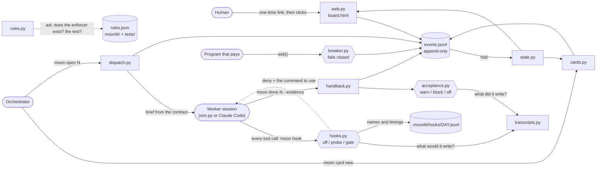
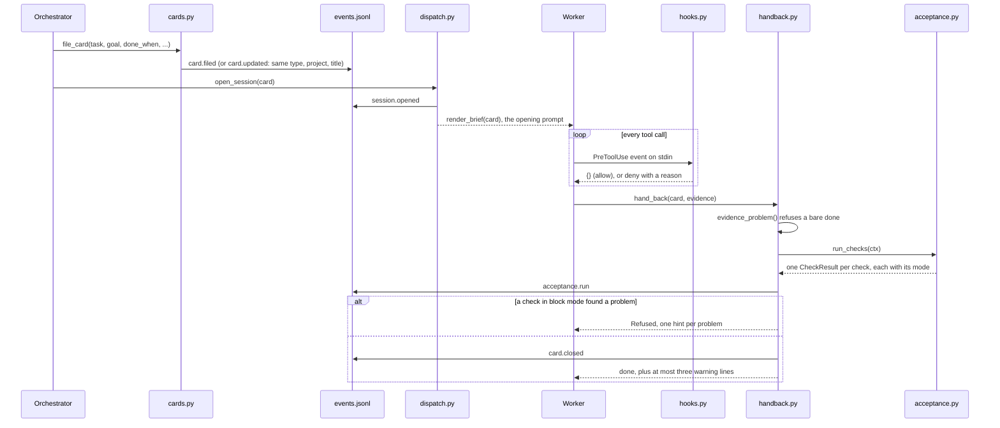

# Architecture

> Part of the moonlit-core showcase. The source it describes is in a private repository for now: *this repo*, and every file and test named on this page, mean that source.

moonlit-core is fifteen Python files in one flat package, `moonlit/`, plus one HTML page. There is no database and no server process to keep alive: every change is a line appended to `.moonlit/events.jsonl`, and every read folds that log into state again. The runtime uses only the standard library.

## Components

The hook sits on the hot path of every tool call, so its cost matters. In this repo the gateway itself takes about 2 ms in process. A call reads the event log only when a gate needs it (a session writing a file, for do-not-touch), so with 10,000 events in the log most calls still take a few milliseconds and those take up to about 150 ms. Claude Code starts a fresh Python process for every `moon hook`, which puts a whole call at roughly 110 to 120 ms with an empty log and nearer 200 ms with 10,000 events. `python evals/run.py` measures all of these on your machine; one run is in [`evals/results/latest.md`](../evals/results/latest.md).

Every box with a `.py` name is a file in `moonlit/`. `events.py` owns the log, `config.py` (workspace, clock, actor) and `cli.py` (the `moon` command) are used by all of them and left out of the picture.

## The life of a card

A check is promoted by the same path in reverse. After seven days of warnings `moon checks review` files a human-only decision with `subject: "check:<name>"`. The human answers it on the board; `web.py` records a `human.click` through the web door; `state.fold` stores the chosen option as the card's `answer`; and `acceptance.check_modes()` reads it back through `cards.answers(state, "check:")`. Nobody writes config. The breaker's switch (`breaker:<program>`), a rule's acknowledgement (`rule:<id>`) and the premium model (`model:<card>:<model>`) work the same way. An answer becomes a setting only on a card filed as the program that asks (`cards.ASKED_BY`: `program:acceptance`, `program:breaker`, `program:rules`, `program:dispatch`); the same subject on a card anyone else files changes nothing. A card with a subject carries no recommendation (DEC-005).

## The files

| File | The one idea | Depends on |
|---|---|---|
| `config.py` | Where things live (`Workspace`), what time it is (`Clock`), who is acting through which door (`Actor`). | nothing |
| `cli.py` | A thin `argparse` CLI; exit codes 0, 1 (refused), 2 (error), 5 (no card). | `config` |
| `events.py` | An append-only log under a cross-process lock. Undo is an event; redact is the one rewrite. | `config`, `cli` |
| `state.py` | State is a pure fold of the log; `verify` replays it and checks five things. | `events`, `config`, `cli` |
| `cards.py` | Five card shapes, who may file what, dedupe, one inbox definition, human-only answers. | `state`, `events`, `config`, `cli` |
| `dispatch.py` | No card, no session: contract → brief → session. | `cards`, `state`, `events`, `config`, `cli` |
| `handback.py` | Handing back needs evidence; runs the checks and applies their modes. | `cards`, `state`, `events`, `config`, `cli`; `acceptance` if present |
| `acceptance.py` | Four checks in plain code; warn until the human decides. | `handback`, `cards`, `transcripts`, `state`, `events`, `config`, `cli` |
| `transcripts.py` | What did the agent actually write? Read from its transcript, not its words. | nothing |
| `hooks.py` | One hook entry for Claude Code: off / probe / gate. Fails open. | `cards`, `state`, `transcripts`, `events`, `config`, `cli` |
| `breaker.py` | A kill switch before money and account actions. Fails closed. One key pays once. | `cards`, `state`, `events`, `config`, `cli` |
| `rules.py` | Each rule names its enforcer and its test; the colour is computed with `ast`. | `cards`, `state`, `events`, `config`, `cli` |
| `web.py` + `board.html` | The human's door: a one-time link swapped for a key the page keeps, Host and Origin checks, click provenance. | `cards`, `state`, `events`, `config`, `cli` |
| `sim.py` | Scripted agents that send real hook events and write real transcripts. | `dispatch`, `state`, `config`; `hooks` if present; `cli` for `moon` steps |
| `demo.py` | The eight acts, in a throwaway workspace. | `acceptance`, `cards`, `cli`, `rules`, `sim`, `state`, `web`, `dispatch`, `events`, `config` |

Each module ends with `register_cli(subparsers)`, which adds its own commands. `cli.py` imports a fixed list of module names and skips any that are not there, so the kernel runs without the guardrail modules, and `handback.py` and `sim.py` likewise run without `acceptance.py` and `hooks.py`.

## Events

One JSON object per line: `seq`, `ts`, `type`, `actor`, `via`, `data`, and `undoes` for an undo. Only `card.*` and `session.*` events can be undone, and not one that came through the web door, filed a human-only card or retired one (`card.superseded`); `events.undoable` is the one test, used by undo, fold and verify. A human's click stands: to change his mind he answers a new card. The other types are records of what happened.

| Type | Written by | Read by |
|---|---|---|
| `card.filed` | `cards.file_card` | `state.fold` |
| `card.updated` | `cards.file_card`, when the same card is filed again | `state.fold` |
| `card.approved` | `cards.approve`: a worker's request becomes the real card | `state.fold` |
| `card.closed` | `handback.hand_back`; `cards.approve` when the card already exists | `state.fold` |
| `card.shelved`, `card.reopened` | `cards.set_status` | `state.fold` |
| `card.superseded` | `cards.supersede`: the program that filed an open human-only card retires it (`breaker.switch_off` retires its switch-on cards); it cannot be undone | `state.fold` (the card is shelved, with the reason) |
| `human.click` | `cards.record_click`, called by `web.py` (`moon click` reaches it too and is always refused) | `state.fold`, which counts a click only if it came through the web door |
| `session.opened`, `session.closed` | `dispatch.open_session` (`moon open`, which registers and starts nothing, and never for a worker), `dispatch.close_session` | `state.fold` |
| `guard.refused` | `cards.guard`, with the rule that refused: `human_only` (not through the web door), `inbox` (a worker at the human's cards), `own_card` (a worker handing back a card its session was not opened for, or shelving or reopening any card), `contract` (a change to a card's contract or to who it waits on, by anyone but the orchestrator, the person at a terminal or the program that filed the card) | `web.board_state` (the refused count) |
| `acceptance.run` | `handback.hand_back` | `acceptance.tally` (`moon checks report`, `moon checks review`), `web.board_state` |
| `breaker.allowed`, `breaker.denied` | `breaker.ask` | `breaker._decide` (idempotency keys, per-day totals) |
| `breaker.off` | `breaker.switch_off` | `breaker.switches`, `breaker.request_on` |
| `hook.demoted` | `hooks._maybe_demote` | `hooks._gate` (observe for the rest of that day) |
| `rule.added` | `rules.add_rule` | `rules.runtime_rules` |
| `log.undo` | `EventLog.undo` | `state.fold` (skips the event it undoes), `state.verify` |
| `log.redacted` | `EventLog.redact` (the count and who ran it) | nobody; it is the audit line |

Not everything is in the log. `hooks.py` writes one line per tool call to `.moonlit/hooks/<day>.jsonl` (tool name, input key names, milliseconds, each gate's verdict, a short hash that tells calls apart; never a value) and its own crashes to `.moonlit/hooks-errors.log`. Each session has `sessions/<id>/brief.md`, and either `transcript.jsonl` (a simulated session writes it) or, for a real Claude Code session, `transcript_path` (where that session keeps its own transcript, noted by the hook the first time it sees the session) and `calls` (one line per tool call the hook saw). Nothing on disk opens the board: the one-time codes and the keys they were swapped for live only in the `moon serve` process. `.moonlit/door.json` says only which port that process listens on, so the gate knows which port is the human's. `moon serve` writes it on start and removes it when stopped with Ctrl+C. A killed serve leaves it behind; the next `moon serve` refuses to start while something still answers on that port, and otherwise writes over it.

## Trust model

These are guardrails for agents that are **cooperative but fallible**: they follow their instructions most of the time, make mistakes, and sometimes take a shortcut. This is not a sandbox against a hostile agent, and it does not try to be.

- **Roles on the command line are labels.** A process's role is `MOONLIT_ROLE`; if that is not set, it is `worker` when `MOONLIT_SESSION` is set and `human` when neither is, and the hook reads it the same way. That `human` is the person at a terminal, with no more power than the orchestrator: nothing only the human may do is reachable through `moon` on the command line (Python that imports the library is another matter, below). `--as` only lowers a role. The labels route cooperative agents. A worker works on the card it was dispatched for: it hands back the card its own session was opened for and no other, shelves and reopens nothing, opens no session, and every new card it files becomes a request that the orchestrator approves or leaves. A card's contract (goal, done-when, read-first, do-not-touch, probe, model, effort) and who the card waits on change only by the orchestrator, the person at a terminal, or the program that filed the card. `approve`, `redact` and undoing someone else's event need the orchestrator's label or a bare terminal's. Words inside a tool call never change who is calling.
- **One identity is not a label: the human via web.** Everything only the human may do (answer a decision, close a human-only action, promote a check, switch the breaker on, acknowledge a rule, allow the premium model) is a `human.click` that came through the web door, and the fold counts no other click. Only `web.py` builds that actor, for a request with this server's Host, an Origin of this server and the key from the one-time link. `config.current_actor()` refuses `via="web"`, and a test checks with `ast` that no other file in the package builds it.
- **The door.** `moon serve` will not start in a process that has a session or any role but `human`. It prints a one-time link in the human's own terminal. Opening it swaps the code for a key that the server hands to that one browser tab, once; the page keeps it in `sessionStorage`, which the browser keeps apart per scheme, host and port, and sends it in an `X-Moonlit-Key` header with every request. No cookie is set, so a dev server on another port of the same machine receives nothing. Without the key, `/` shows how to get in and `/api/*` answers 401. The key is what keeps the door shut; the gate is a second line. With the gate on, the `human_door` category (it ships in `block` and never switches itself back to `observe`) denies an agent session the usual ways to open the door or knock on it: `moon serve` and `moon --as` (also through `python -m moonlit`, `py -m moonlit` or a path to `moon`), setting or dropping `MOONLIT_ROLE`, `MOONLIT_SESSION` or `MOONLIT_HOOKS` where a shell assigns (`X=y cmd`, `export`, `unset`, `env -u`, `$env:X =`, `Remove-Item Env:X`), and HTTP to this machine on the port in `door.json`. A name inside an ordinary argument is no assignment, so `grep MOONLIT_ROLE= notes.txt` is allowed. A dev server on another port is the agent's own business, and with no board open there is nothing to knock on.
- **Where the gate stops.** The gate reads command lines, not code, so it is a guardrail and not a sandbox. It reads the command as typed and one shell level down (`bash -c`, `sh -c`, `cmd /c`, `powershell -Command`, `eval`), and knows the common spellings. It does not see a second level of nesting, a script file the command runs, another interpreter (`python -c`, a .NET call), a path or port held in a shell variable, or a raw socket. An agent that can run Python can also import `moonlit` and write a forged web click itself, because the log is not signed. With the gate off, a determined agent can start its own `moon serve` and open the link it prints. The eval suites keep each of these as an `expected_miss` case (H-129, and H-143 to H-160 among others), so the known gaps are counted, not hidden.
- **The log is not tamper-proof.** Nothing is signed, so whoever can write `.moonlit/events.jsonl` can write a consistent lie. `moon replay --verify` checks five things and no more: every line but a torn last one is an event, and `seq` grows by one; only `log.undo` carries `undoes`, and only for an earlier change that can be undone; every card marked done has evidence; a human-only card was closed through the web door; no card has two open sessions. That catches accidental damage and a careless hand edit that breaks one of the five. It does not check who changed a contract or sent a click, and a forgery that keeps the five passes. With the gate on, `protected_paths` (it ships in `block` and never demotes) denies the writes it can see to anything under `.moonlit/`, to `rules.json` and to the workspace's `.claude/settings.json` or `.claude/settings.local.json`, and deleting or moving a folder that holds them, within the limits of the bullet above.
- **Known limits, not fixed.** `MOONLIT_TEST_NOW` freezes the clock from the environment, so whoever sets it backdates the events it writes; the breaker then approves no money. `moon card new --project ../elsewhere` puts the project folder, a session's working folder and the base of its do-not-touch patterns outside the workspace, and the `cd` and environment lines that `moon open` prints are not quoted, so a path with spaces has to be quoted by hand.
- **Failure policy.** The hook fails open: a gate that crashes lets the call past itself (the other gates still answer), any other error allows the call, and each is logged, because a broken guard must not stop every agent. The breaker fails closed: any error is a no, because a broken breaker must not move money.

## Three extension points

Each is one table in one file, and each has a worked exercise in the walkthrough that ships with the source.

1. **A card type**: one entry in `SHAPES` in `cards.py` (required and optional fields). Validation goes in `check_shape`. Whether the type belongs in the human's inbox is decided in `waiting_on_human`; listing it in `INBOX_TYPES` also keeps workers off it (`guard`) and makes a worker's refiling of an open one a request.
2. **An acceptance check**: a function `(HandbackContext) -> (outcome, message)` plus one entry in `CHECKS` and `HINTS` in `acceptance.py`. It starts in warn mode and joins `moon checks report` and `review` on its own.
3. **A gate category**: a function `(Call) -> reason or None` plus one entry in `GATES` in `hooks.py`. It starts in `observe` and blocks only when `hooks.categories.<name>` is set to `block`; to ship it in `block`, add it to `FACTORY_MODES`. Only a category in `DEMOTABLE` demotes itself.

Smaller ones: a breaker limit is a key in `LIMIT_KEYS` and a check in `breaker._decide`; a simulated persona is a list of steps in `sim.py`; a new kernel event is one entry in `state.HANDLERS`.
